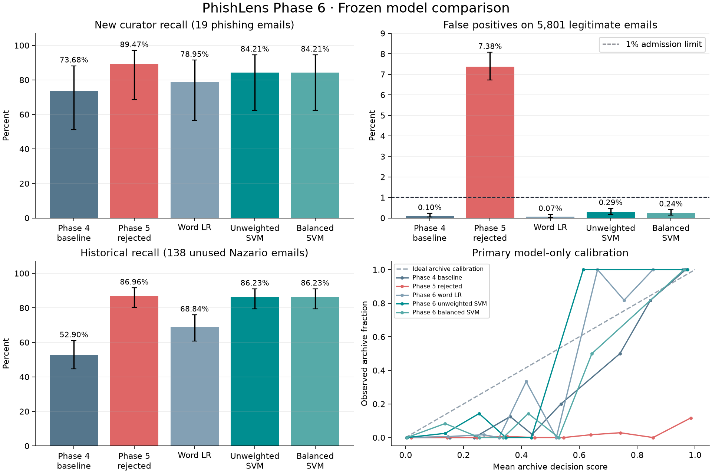
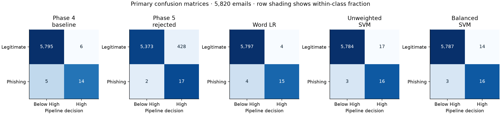

# Phase 6 model evaluation

The validation-selected unweighted word-and-character Linear SVM passed all frozen numerical admission gates and is active for limited local research. In the primary comparison it flagged 16 of 19 reviewed phishing messages, up from 14, with 17 false positives among 5,801 legitimate messages, up from 6. Precision fell from 70.00% to 48.48%, and F1 fell from 0.7179 to 0.6154. The prespecified policy prioritized recall with a bounded increase in false positives.

The 19 primary positives span 10 lexical campaign groups. The selected recall interval is 62.43%–94.48% by row-wise Wilson and 45.32%–100.00% by the source-stratified campaign bootstrap. The paired comparison recovered two positives and lost zero, with row-level exact p=0.50. This sample supports a limited benchmark result with substantial uncertainty about new inboxes. [Frozen protocol](docs/ml/phase6/PROTOCOL.md) · [Dataset provenance](DATASET_PROVENANCE.md)

## Validation-only selection

Training used 9,322 rows, calibration 3,108, internal diagnostic test 3,108 and validation 7,351. The source and era held-out validation set includes 827 positives and 6,524 legitimate messages. Every candidate passed pooled and eligible per-source FPR constraints. Selection used validation recall, lower FPR and lower log loss in that order. The selected threshold is `0.2095991955762941`. The final dataset remained sealed from fitting, calibration and selection.

| Phase 6 candidate | Frozen threshold | Validation recall | Validation FPR | Internal test F1 |
|---|---:|---:|---:|---:|
| Phase 6 word LR | 0.465642 | 64.69% | 0.17% | 0.8458 |
| Phase 6 unweighted SVM | 0.209599 | 89.00% | 0.25% | 0.9024 |
| Phase 6 balanced SVM | 0.316981 | 87.79% | 0.20% | 0.9205 |

## Primary comparison

All five frozen models saw the same bounded, parsed text. Model-only metrics apply English scoring to every message as a diagnostic. The complete pipeline routes by language, uses the original Spanish classifier where applicable and retains rule-based assessment for abstentions. A negative pipeline decision means below the High threshold.

### Model only

| Model | Accuracy | Precision | Recall | F1 | FPR | FNR | [[TN, FP], [FN, TP]] |
|---|---:|---:|---:|---:|---:|---:|---|
| Phase 4 baseline | 99.81% | 68.18% | 78.95% | 0.7317 | 0.12% | 21.05% | `[[5794, 7], [4, 15]]` |
| Phase 5 rejected | 90.93% | 3.47% | 100.00% | 0.0671 | 9.10% | 0.00% | `[[5273, 528], [0, 19]]` |
| Phase 6 word LR | 99.86% | 78.95% | 78.95% | 0.7895 | 0.07% | 21.05% | `[[5797, 4], [4, 15]]` |
| Phase 6 unweighted SVM | 99.66% | 48.57% | 89.47% | 0.6296 | 0.31% | 10.53% | `[[5783, 18], [2, 17]]` |
| Phase 6 balanced SVM | 99.73% | 54.84% | 89.47% | 0.6800 | 0.24% | 10.53% | `[[5787, 14], [2, 17]]` |

### Complete pipeline with format-aware routing

| Model | Accuracy | Precision | Recall | F1 | FPR | FNR | [[TN, FP], [FN, TP]] |
|---|---:|---:|---:|---:|---:|---:|---|
| Phase 4 baseline | 99.81% | 70.00% | 73.68% | 0.7179 | 0.10% | 26.32% | `[[5795, 6], [5, 14]]` |
| Phase 5 rejected | 92.61% | 3.82% | 89.47% | 0.0733 | 7.38% | 10.53% | `[[5373, 428], [2, 17]]` |
| Phase 6 word LR | 99.86% | 78.95% | 78.95% | 0.7895 | 0.07% | 21.05% | `[[5797, 4], [4, 15]]` |
| Phase 6 unweighted SVM | 99.66% | 48.48% | 84.21% | 0.6154 | 0.29% | 15.79% | `[[5784, 17], [3, 16]]` |
| Phase 6 balanced SVM | 99.71% | 53.33% | 84.21% | 0.6531 | 0.24% | 15.79% | `[[5787, 14], [3, 16]]` |

| Model | Recall Wilson 95% | FPR Wilson 95% | Recall campaign bootstrap 95% |
|---|---:|---:|---:|
| Phase 4 baseline | 51.21%–88.19% | 0.05%–0.23% | 20.00%–94.29% |
| Phase 5 rejected | 68.61%–97.06% | 6.73%–8.08% | 60.00%–100.00% |
| Phase 6 word LR | 56.67%–91.49% | 0.03%–0.18% | 30.00%–95.35% |
| Phase 6 unweighted SVM | 62.43%–94.48% | 0.18%–0.47% | 45.32%–100.00% |
| Phase 6 balanced SVM | 62.43%–94.48% | 0.14%–0.40% | 45.32%–100.00% |

Wilson intervals treat individual rows as trials. The 400-replicate bootstrap keeps whole campaign groups together and stratifies by source membership. These intervals describe the curated samples.

## Source and routing differences

| Frozen model | TREC-07 ham FPR (5,801) | Phishing Pot recall (19) | Nazario 2019 recall (138) | Broader financial scam recall (7) |
|---|---:|---:|---:|---:|
| Phase 4 baseline | 0.10% | 73.68% | 52.90% | 28.57% |
| Phase 5 rejected | 7.38% | 89.47% | 86.96% | 85.71% |
| Phase 6 word LR | 0.07% | 78.95% | 68.84% | 28.57% |
| Phase 6 unweighted SVM | 0.29% | 84.21% | 86.23% | 57.14% |
| Phase 6 balanced SVM | 0.24% | 84.21% | 86.23% | 71.43% |

The historical stress uses the same 5,801 legitimate emails and 138 previously unused Nazario 2019 phishing messages. The selected pipeline detected 119 versus 73 for the baseline, with 46 recovered positives and no lost positives. Nazario also supplied development mail from other years, so the result measures unseen messages from a familiar curator. Seven broader financial scams form a separate small comparison.

On the reviewed Phishing Pot positives, the old and new routes applied English ML to 17/19 and 17/19 respectively. The current gate abstained on two English messages assigned unsupported language codes. Format cleanup resolves some invisible-character cases while mixed-script lookalikes remain difficult. On observed Spanish diagnostics it selected Spanish for 130/139 versus 129/139 with the prior gate, with every previously supported expected-Spanish route preserved. [Observed routing audit](docs/ml/phase6/routing-development-frozen.json)

In the primary comparison the selected pipeline missed three positives and flagged 17 legitimate messages. Its paired change consists of two recovered positives, four corrected legitimate decisions and 15 newly flagged legitimate messages. The word LR achieved higher primary F1 with one fewer detected positive. Its validation recall was lower, so it stays inactive under the frozen selection policy. The Phase 5 candidate still flags 428 legitimate messages on this new source and remains rejected.

The unchanged rule-only High operating point flagged 0/19 positives and 0/5,801 legitimate messages. At the review threshold those counts are 4/19 and 0/5,801. Subject/body archives omit many transport and attachment signals available in an original submission.

## Ranking and calibration on the primary model-only scores

| Frozen model | ROC-AUC | Average precision | Trapezoidal PR-AUC | Brier | Log loss | ECE |
|---|---:|---:|---:|---:|---:|---:|
| Phase 4 baseline | 0.9978 | 0.8227 | 0.8208 | 0.0042 | 0.0181 | 0.0135 |
| Phase 5 rejected | 0.9861 | 0.1501 | 0.1840 | 0.0429 | 0.2919 | 0.0851 |
| Phase 6 word LR | 0.9918 | 0.8356 | 0.8345 | 0.0028 | 0.0180 | 0.0140 |
| Phase 6 unweighted SVM | 0.9991 | 0.9077 | 0.9067 | 0.0010 | 0.0088 | 0.0070 |
| Phase 6 balanced SVM | 0.9995 | 0.9260 | 0.9249 | 0.0011 | 0.0079 | 0.0060 |

Calibration used a disjoint archive partition with 125 positives out of 3,108 messages. The primary holdout has 19 positives out of 5,820. Source, label and prevalence shifts limit what either distribution says about a future inbox. The application presents archive decision scores, and the deployment probability flag is false. Binary routing/fallback decisions have operating metrics only. Ranking metrics for one-class sources are undefined.

## Release decisions

| Model | Decision |
|---|---|
| Phase 6 unweighted SVM | Approved for limited local use. Fixed threshold and artifact hash are bound to the admission record. |
| Phase 6 word LR and balanced SVM | Experimental and inactive. Selection was fixed before final scoring. |
| Phase 4 English baseline | Experimental and retained for comparison and local rollback. |
| Phase 5 English candidate | Rejected and inactive. |
| Original Spanish and hostname URL models | Approved for limited use within their documented archive scopes. |

The packaged independent evaluation contains aggregate model-only and routed results, including per-source metrics, confusion matrices, intervals, calibration and paired comparisons. Per-message hashes and scores remain in the local evidence. [Aggregate independent evaluation](docs/ml/phase6/independent-evaluation.json) · [Training selection](docs/ml/phase6/selection.json) · [Local admission](backend/models/email_en_v6/email-source-text-v6-609bba638c1d/admission.json) · [Root-cause report](docs/ml/phase6/ROOT_CAUSES.md)
