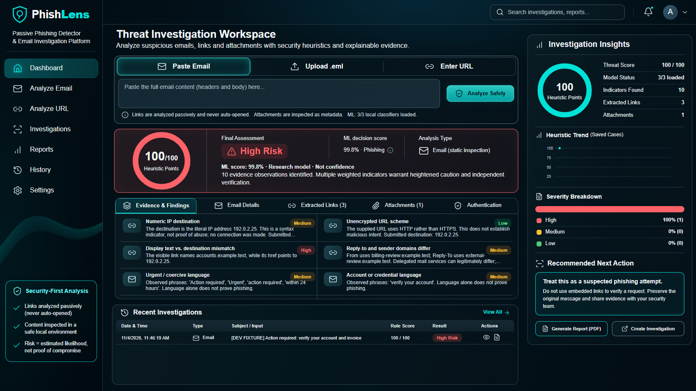

# PhishLens

**A local phishing investigation workspace for passive email and URL analysis, explainable evidence, and case reports.**

PhishLens helps an analyst inspect emails and URLs, review the evidence behind an assessment, preserve an investigation and produce a PDF report. React and TypeScript provide the navy/teal dashboard; FastAPI, SQLite and scikit-learn provide the local analysis and persistence.

**The public source runs in rules-only mode out of the box.** The trained English email, Spanish email and hostname classifiers belong to the separate local research workspace and are excluded from this repository. The English classifier is approved for limited local analyst use. On its small independent test, it detected 16 of 19 phishing messages versus 14 for the baseline, while false positives rose from 6 to 17 among 5,801 legitimate messages. F1 declined. Treat all model outputs as research signals for analyst review. Keep them out of automated security decisions. [Model evaluation](MODEL_EVALUATION.md)

## Screenshots



[Email analysis](docs/ml/phase6/screenshots/email-en.png) · [Investigation review](docs/ml/phase6/screenshots/investigation-en.png)

These three captures use synthetic fixtures in the optional ML-enabled local workspace. The rules-only install uses the same layout and labels unavailable classifiers explicitly. The owner approved publication of these screenshots and the visible branding. [Third-party notices](THIRD_PARTY_NOTICES.md)

## Features

| Page | What it does |
|---|---|
| Dashboard | Paste an email, upload `.eml` or submit a URL; review separate rule points/model assessments, evidence tabs and charts derived from saved cases. |
| Analyze Email | Inspect raw/parsed/header views, extracted links, attachment metadata, language/model scope and findings; save or report the analysis. |
| Analyze URL | Examine HTTP(S) syntax and hostname-model output passively, with complete-URL rules separate from ML. |
| Investigations | Search, filter, sort and paginate cases; reopen evidence, change status, edit analyst notes and inspect timelines. |
| Reports | Generate and retrieve PDFs from saved evidence and case snapshots. |
| History | Find and reopen prior analyses; explicitly confirm deletion of associated local records. |
| Settings | Inspect loaded model versions and limitations, adjust display density and manage local data. |

Submitted URLs are never automatically visited or resolved. Email HTML becomes inert text. Attachments receive metadata/SHA-256 inspection, not execution or malware scanning. SPF/DKIM/DMARC values are unverified supplied-header observations; unavailable age, ownership and reputation evidence stays unknown.

## Start on Windows

Install **Python 3.11** and **Node.js 22**. Open PowerShell in your checkout, replacing the folder placeholder below. The correct folder contains `package.json`, `frontend/` and `backend/`.

```powershell
Set-Location '<path-to-PhishLens>'
py -3.11 -m venv .venv
.\.venv\Scripts\python.exe -m pip install -r backend\requirements.txt
npm ci
```

Using the environment's executable directly avoids a PowerShell activation-policy dependency. If `py -3.11` cannot locate an installed Python, run `-m venv .venv` with your Python 3.11 `python.exe` by its full path. The core requirements run the rules-only application. Optional ML inference, training, and the full test suite require `backend/requirements-ml.txt`.

Start the API in one terminal:

```powershell
.\.venv\Scripts\python.exe -m uvicorn backend.main:app --host 127.0.0.1 --port 8000
```

In a second terminal, change to the same project folder and start the frontend:

```powershell
npm run dev
```

Open [PhishLens](http://127.0.0.1:5173/). The [API schema](http://127.0.0.1:8000/openapi.json) describes endpoints. Keep both services on loopback and stop them with Ctrl+C. Restart the API after intentional runtime/model changes; saved results keep their original snapshots.

## Classifier status and optional weights

| Classifier | Decision and scope |
|---|---|
| Spanish email | **Approved for limited use:** the retained SpaPhish archive classifier supports Spanish within its documented evaluation scope. Contemporary inbox calibration and dependable field detection are not established. |
| Hostname URL | **Approved for limited use:** the retained PhiUSIIL classifier examines hostname features. Collection artifacts and prevalence shift limit interpretation; it does not inspect destination content. |
| English baseline | **Experimental:** retained as a historical baseline in the complete local workspace. Poor independent generalization/calibration prevents a production-reliability claim. |
| Phase 5 English candidate | **Rejected and inactive:** independent false positives failed the frozen admission limits. Original artifacts remain preserved. |
| Phase 6 unweighted word-and-character SVM | **Approved for limited local use.** The complete local registry selects `email-source-text-v6-609bba638c1d`. |
| Phase 6 word LR and balanced SVM | **Experimental and inactive.** Validation selected the unweighted SVM before final scoring. |

This package includes classifier metadata and evaluation summaries. The complete trusted registry stays in the private research workspace. [Distribution policy](GITHUB_READINESS.md)

Absent, corrupt, incompatible or inapplicable optional models cause explicit deterministic heuristic fallback. Missing English never substitutes Spanish. Mixed, uncertain, unsupported and short text can abstain. Language identification is imperfect, including on obfuscated or technical text.

Only install owner-reviewed, trusted project artifacts in their documented `backend/models/` directories, with matching manifests/metrics and feature code. Joblib is executable pickle-based serialization, not a safe upload format. Do not deserialize an arbitrary downloaded model. Inspect available models with:

```powershell
.\.venv\Scripts\python.exe scripts/check_model_registry.py
```

A corrupt present bundle fails this check; missing optional weights are disclosed as unavailable. An omitted model is never called a trained-model test pass.

## Evidence and ML methodology

Heuristic risk, ML classification, model decision score and final assessment are distinct. The main ring represents rule points. Learned scores are archive decision scores rather than confidence; legacy probability fields remain for saved-result compatibility. Neither a legitimate prediction nor low rule points verifies safety. Cases and reports preserve the captured model/version and evidence.

Experiments use actual licensed data, source/campaign grouping, train-only vocabularies, separate calibration and validation-only thresholds. Generic spam is not silently relabeled phishing. Previously observed external sets become development evidence in later phases. New independent comparisons are frozen before final scoring, with source results, intervals and calibration limitations reported.

The Phase 6 protocol limits the new search to three justified word/character TF-IDF LR/SVM candidates, regularization/weighting ablations and versioned normalization. Admission targets empirical FPR at most 1%, upper 95% bound at most 2%, and no unacceptable regression. Stronger F1 alone is insufficient. See [the frozen protocol](docs/ml/phase6/PROTOCOL.md).

Phase 6 primary pipeline results use 19 reviewed phishing messages from a new curator and 5,801 legitimate messages from the held-out TREC-07 source.

| Frozen English system | Recall | False positives | F1 |
|---|---:|---:|---:|
| Phase 4 baseline | 14/19 (73.68%) | 6/5,801 (0.10%) | 0.7179 |
| Phase 5 rejected candidate | 17/19 (89.47%) | 428/5,801 (7.38%) | 0.0733 |
| Phase 6 selected SVM | 16/19 (84.21%) | 17/5,801 (0.29%) | 0.6154 |

The selected SVM met the frozen recall and false-positive gates. Its two additional detections came with 11 additional false positives and lower F1. The phishing sample contains 10 lexical campaign groups. The row-wise 95% recall interval is 62.43% to 94.48%. These results describe the optional English model pipeline. The GitHub rules-only default uses a separate heuristic assessment. [Model evaluation](MODEL_EVALUATION.md) · [Root-cause analysis](docs/ml/phase6/ROOT_CAUSES.md)

## Reproduce the research

The public evidence contains source-level attribution, aggregate results, the frozen protocol and the research scripts. Exact replay requires the reviewed local inputs, including the original row-level evidence and trusted model artifacts. The reproduction guide identifies these prerequisites and separates aggregate checks from the owner-only replay. [Dataset provenance](DATASET_PROVENANCE.md) · [Reproduction guide](docs/ml/phase6/COMMANDS.md)

## Tests and verification

Install the pinned Python test dependencies after the rules-only setup. Run these commands from the extracted package root. On Windows the browser configuration uses installed Chrome or Edge, with `PLAYWRIGHT_EXECUTABLE_PATH` available for another compatible Chromium installation. On Linux, install the Playwright Chromium browser with `npx playwright install chromium`.

```powershell
.\.venv\Scripts\python.exe -m pip install -r backend\requirements-lock.txt
.\.venv\Scripts\python.exe -m pip check
.\.venv\Scripts\python.exe scripts/check_model_registry.py
.\.venv\Scripts\python.exe -m pytest backend/tests -m 'not real_models' -q
npm test
npm run typecheck
npm run build
npm run format:check
npx playwright test tests/e2e/application.spec.ts
```

These checks cover rules-only operation. The registry reports the intentional absence of the three optional classifiers. Playwright uses a dedicated test database and loopback ports 8010 and 5180. Native PDF completion and the PDF response are checked separately. [Browser checks and manual download](docs/ml/phase6/QA_VERIFICATION.md)

## Local data and security

Default SQLite storage is `backend/data/phishlens.sqlite3`. Set `PHISHLENS_DB` in the API terminal before startup to choose another file; `.env` is not loaded automatically. Email content, cases, notes and report snapshots are sensitive local records excluded from Git. Use SQLite's online backup API for a consistent live backup. Deletion does not securely erase external backups, OS caches or forensic remnants.

The supported deployment is a **trusted single-operator local setup**. Host/Origin protections reduce hostile browser access, but do not provide authentication or tenant isolation. A hosted version needs authentication/authorization, HTTPS, storage isolation, quotas, retention and trusted model provisioning. Do not expose this unauthenticated API to an untrusted network. See [SECURITY_AUDIT.md](SECURITY_AUDIT.md).

## Troubleshooting

| Symptom | Action |
|---|---|
| `.venv\Scripts\python.exe` is not recognized | Change to the folder containing `package.json` and `backend/`. Check `Test-Path .\.venv\Scripts\python.exe`; if absent, create it with `py -3.11 -m venv .venv`. |
| `python` opens the Windows Store | Use `py -3.11` to create the environment, then its explicit executable above. |
| Port 8000 or 5173 is occupied | Inspect the service already using it. Stop only a service you own, or deliberately configure matching API/frontend ports and origins. Do not terminate unrelated processes. |
| A model is unavailable | Read Settings/API health and run `scripts/check_model_registry.py`. Weights may be intentionally omitted; install only reviewed matching files and the exact supported scikit-learn version from `requirements-ml.txt`. Rules remain available. |
| Runtime/model changes are not visible | Restart the API. Saved analyses intentionally retain their original version; submit a new analysis for current inference. |
| Short, mixed or unsupported text receives rules only | This is an explicit applicability fallback, not a safe verdict. |
| PDF download is canceled under automation | Check native transfer separately from HTTP/render verification. Try a normal local browser outside the automation sandbox; do not disable protections to manufacture a pass. |
| Automatic E2E teardown stalls on Windows | Start the isolated QA servers using the browser verification procedure. Keep the test-mode guard enabled. |

## Documentation and licensing

[Architecture](docs/ARCHITECTURE.md) · [Model evaluation](MODEL_EVALUATION.md) · [Dataset provenance](DATASET_PROVENANCE.md) · [Security audit](SECURITY_AUDIT.md) · [Release scope](GITHUB_READINESS.md)

The MIT license covers owner-authorized original code and documentation. Dependencies and datasets carry their own terms. The included application captures and branding are published with owner permission. [MIT license](LICENSE) · [License scope](LICENSE.NOTICE.md) · [Third-party notices](THIRD_PARTY_NOTICES.md)

The file manifest identifies the package contents and their SHA-256 values. The package audit records the scan findings and the owner's approval. [File manifest](PUBLIC_RELEASE_MANIFEST.json) · [Package audit](PUBLIC_RELEASE_AUDIT.json)
