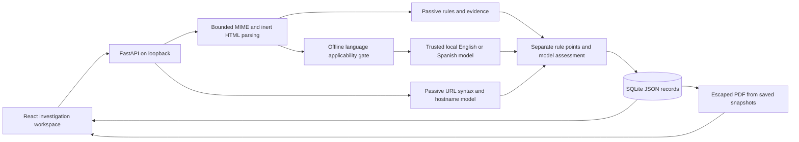

# PhishLens architecture

PhishLens is a single-operator, local email and URL investigation workspace. React and TypeScript present the dashboard; FastAPI performs bounded passive analysis; SQLite stores submitted evidence and immutable report snapshots. The trained classifiers add narrowly scoped learned decisions alongside explainable rule observations. They are not a security oracle, an attachment sandbox or a destination crawler.

Submitted links and attachments have no outgoing network/execution path. Dataset acquisition and training are separate, operator-invoked command-line workflows; the analysis API does not train models, fetch datasets or accept serialized models.

## Components and contracts

| Component | Responsibility |
|---|---|
| `frontend/src/App.tsx` and page components | Seven application pages, input validation, evidence views, stored-data charts, investigation review and report actions. React renders submitted strings as text. |
| `backend/main.py` | Typed API payloads, bounded request middleware, local Origin/Host checks, case/report lifecycle and metrics over saved records. |
| `backend/analysis.py` | MIME limits, inert HTML text extraction, passive URL parsing, attachment metadata/SHA-256 and deterministic evidence. It performs no destination fetch or DNS lookup. |
| `backend/ml_runtime.py` | Trusted local artifact loading, integrity/compatibility checks, language routing, bounded inference and explicit heuristic fallback. |
| `backend/language_routing_v3.py` | Offline English/Spanish applicability with narrow invisible-character cleanup and mixed, short, unsupported and uncertain abstention. The v2 module remains available for archived comparisons. |
| `backend/storage.py` | Parameterized SQLite JSON-record persistence. Analyses, cases and reports use distinct record kinds. |
| `backend/reports.py` | Escaped, inert ReportLab PDF generation from stored analysis/case snapshots. No live input reanalysis occurs on download. |
| `backend/ml_training*.py`, `scripts/` | Reproducible, provenance-bound dataset preparation, controlled fitting, threshold selection, evaluation and release audits. Raw datasets stay outside source assets. |

The primary risk ring remains heuristic points. A learned decision, its archive score, the final assessment and observed security evidence are stored separately. Model output does not independently verify email authentication, ownership, reputation, attachment safety or a compromise. The current model decision and score semantics are specified in [the inference contract](ml/INFERENCE.md).

## Persistence and compatibility

The default database is `backend/data/phishlens.sqlite3`, configurable through `PHISHLENS_DB`. Schema v1 uses a `records(kind,id,data)` table and JSON payloads. Connections enable foreign keys and WAL mode; inserts/updates use parameterized SQL. The implementation initializes v1 idempotently. Database preservation and any Phase 6 schema guard are verified in the final Phase 6 report; no automatic destructive data migration is part of the release.

Analyses retain their original evidence/model snapshots. Creating a case stores the selected analysis and initial timeline; editing notes/status changes that case, not earlier saved reports. Report creation stores both analysis and case snapshots. Download re-renders that stored snapshot and keeps its captured model version; it does not load a newer classifier to rewrite history. Legacy records lacking ML fields retain their historical fallback behavior. Case charts derive from persisted case values, never screenshot sample numbers.

Application cascade deletion is implemented in the API. The current single-user store is not a concurrent multi-tenant database: case updates and multi-record operations have no distributed transaction or conflict-resolution layer. Backups, operating-system caches and forensic erasure are outside application deletion semantics. Use SQLite's online backup API for a consistent live backup.

## Runtime and trust boundaries

The supported development setup binds the API to `127.0.0.1:8000` and Vite to `127.0.0.1:5173`. Playwright uses isolated ports 8010/5180 and an explicitly flagged test database. Tests refuse to clear data unless the API reports isolated test mode. No production user database is an E2E target.

The application has no remote authentication, tenant isolation, hosted upload quarantine or background investigation service. Host/Origin defenses reduce hostile browser access to a local service; they do not authenticate a native client. A public hosted deployment needs a separate security design. See [SECURITY_AUDIT.md](../SECURITY_AUDIT.md) and [GITHUB_READINESS.md](../GITHUB_READINESS.md).

Model files are executable pickle-based serialization. Only trusted, project-owned files may be installed. The runtime checks path containment, hashes, code identity, version, language scope and evaluation metadata before loading them; an administrator who replaces both artifact and metadata remains inside the trust boundary. A missing or failed model preserves deterministic heuristic analysis.

## Training and release boundaries

Training vocabularies and estimators fit only permitted development partitions. Calibration, threshold selection and final evaluation have separate roles; a previously observed external benchmark becomes development evidence in the next phase. Final source/campaign grouping and actual sample counts are reported with each experiment. Dataset licensing and model admission are different decisions: passing a benchmark does not grant redistribution rights, and a publisher's license does not establish deployment reliability.

Historical Phase 3–5 reports and original artifacts remain local, unchanged evidence. A public copy can omit private/generated material and redact personal machine paths only in identified copies with original/copy hashes. It must not rewrite the historical originals or claim a sanitized metadata file has its original checksum. The release inventory script is read-only and reports locations without printing matched credential values.
